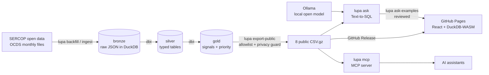

# Lupa Pública 🔎

**Ecuador's public procurement, easy to review.** Lupa Pública turns the open data that
SERCOP publishes (342,282 procurement processes, about US$ 12.9 billion, Nov 2024 – Oct 2026)
into a fast search site, entity profiles, a province map, statistically sound **risk
signals** and an AI that answers questions in plain Spanish, without sending anyone's data
to a server.

**🌎 Live site: [fabricioanchundia.github.io/Lupa-publica](https://fabricioanchundia.github.io/Lupa-publica/)**

[](https://github.com/Fabricioanchundia/Lupa-publica/actions/workflows/ci.yml)
[](https://github.com/Fabricioanchundia/Lupa-publica/actions/workflows/web.yml)


> Risk signals are **reasons to look closer, never accusations of wrongdoing.** Each one
> compares an entity with others that buy similar things and has a public methodology.

🇪🇨 [Resumen en español](#-en-español)

---

## What you can do

| | Feature | How it works |
|---|---|---|
| 🔍 | **Search every contract** by description, entity or supplier, with filters (province, year, category, procedure, "only with signals") | DuckDB runs **inside the browser** (WebAssembly) on the public datasets: no backend, nothing you search leaves your device |
| 🏛️ | **Entity profiles**: totals, the three signals explained in one sentence each, concentrated suppliers, largest contracts | Same in-browser queries, linked from every table |
| 🗺️ | **Province map** for four metrics, with a ranked table | Natural Earth boundaries pre-converted to SVG, no map service |
| 🚩 | **Review priority**: 12 entities to review first, 62 to review | Leave-one-out baselines, Poisson tail, Benjamini-Hochberg FDR |
| 🤖 | **Ask in Spanish**: "¿Qué hospitales tienen más contratos de una sola oferta?" | Text-to-SQL with a local open model, two safety locks, and the SQL shown with every answer |
| 📚 | **Ask about procurement law**: answers that cite the exact article of the LOSNCP or its regulation | RAG: 562 articles embedded locally (bge-m3), every citation checked against the articles retrieved |
| 🔌 | **Use it from an AI assistant** (Claude Desktop, IDE agents) | `lupa mcp`: an MCP server with read-only tools over the public data and the law |
| 🔄 | **Fresh data every month**, with nobody pressing a button | A scheduled GitHub Actions robot re-downloads the last 24 months, rebuilds and tests everything, and stops itself if the new data looks broken |
| ✋ | **Right of reply**: any entity can ask for a correction | GitHub issue template, public and logged |

## Risk signals

| Code | Signal | Source | Methodology |
|---|---|---|---|
| R018 | Single bid received in a competitive process | Open Contracting Partnership red flags (Cardinal) | [r018-single-bid.md](docs/indicators/r018-single-bid.md) |
| R003 | Unusually short submission period | Open Contracting Partnership red flags (Cardinal) | [r003-short-period.md](docs/indicators/r003-short-period.md) |
| LP01 | One supplier wins an unusual share of an entity's contracts in a category | Own | [lp01-supplier-concentration.md](docs/indicators/lp01-supplier-concentration.md) |
| LP02 | Unusually high unit price (**experimental**, not published) | Own | [lp02-unit-price.md](docs/indicators/lp02-unit-price.md) |

An entity is flagged only when its excess is **both** unlikely to be chance (q < 0.05 after
correcting for hundreds of comparisons, at least 3 cases) **and** large enough to matter.
Entities with too little data are labeled "insufficient data", never ranked.
Details: [docs/indicators](docs/indicators/README.md).

## Architecture



- **Monthly robot**: `.github/workflows/refresh.yml` runs the whole pipeline on GitHub
  Actions (free for public repositories), compares the new export with the published one
  (`lupa check-release`) and only then publishes. Why: [ADR-0010](docs/adr/0010-monthly-refresh-on-github-actions.md).
- **Medallion layout** in one DuckDB file; transformations in **dbt** with unit tests,
  data tests and a privacy test that fails the build if a person's identity leaks.
- **Static site**: React 19 + Vite + TypeScript, DuckDB-WASM, strict Content Security
  Policy (own files only). Data files travel as a GitHub Release, not in git.
- **AI without a server**: questions are answered by an open model running locally
  (Ollama, `qwen2.5:7b`). The website shows a reviewed gallery whose SQL each visitor
  can re-run in the browser. Why: [ADR-0006](docs/adr/0006-text-to-sql-with-local-model.md).

Every important decision has an [Architecture Decision Record](docs/adr/README.md).

## How good is the AI? (measured)

The AI takes a fixed exam with answers checked by a person ([`evals/`](evals),
[ADR-0009](docs/adr/0009-ai-evaluation.md)). Text-to-SQL is graded by **execution
accuracy**: the model's SQL and a reference SQL run on the same data and must return the
same values. Every run is saved in [`evals/results/`](evals/results).

| Exam | Model | Result |
|---|---|---|
| Questions about the data (18) | `qwen2.5:7b` | **17/18 correct (94%)**, 0 retries, 0 unverified numbers |
| Questions about the data (18) | `qwen2.5-coder:7b` | 17/18 correct (94%), a different miss |
| Must decline (4): ID numbers, deleting data, unknown owners, predictions | both | **4/4 declined** |
| Questions about the law (8) | `qwen2.5:7b` | **8/8 cite the right article** (first run: 6/8), 0 invented citations |
| Traps the law does not cover (3) | `qwen2.5:7b` | **3/3 "not found"** |

What the exam caught, and how each was fixed: declining to *count* anonymous persons
(rule clarified), citing the Law for an article of the Regulation (sources named in the
context), citations to an item of an article rejected by the checker (checker fixed),
counting processes instead of distinct suppliers (described in the semantic layer; the
coding model still misses it, the general model does not). With 33 questions the exam
catches regressions and compares models; it is not a precise accuracy estimate.

## Privacy and AI safety

- **Natural persons are never published by name or ID number.** Suppliers who are people
  appear as `Persona #` plus 6 characters of a keyed hash (HMAC-SHA256, secret key kept
  out of git) ([ADR-0004](docs/adr/0004-supplier-privacy.md)).
- **Public export allowlist.** Only listed columns are exported; ID numbers in free text
  are masked; every value is scanned for personal identifiers and the export fails if
  one is found.
- **Two locks on AI-written SQL.** (1) The SQL is parsed, never trusted: one read-only
  `SELECT` over the public tables only, no file or settings functions, row limit.
  (2) It runs in an in-memory database that holds only public data and is locked
  (no file or network access, settings frozen, time limit).
- **Numbers come from the data, not the model.** The AI's summary is labeled as such, and
  numbers in it that are not in the result are flagged.

## Run it yourself

Requirements: Python 3.12 + [uv](https://docs.astral.sh/uv/), Node 22, and optionally
[Ollama](https://ollama.com) for the AI.

```bash
git clone https://github.com/Fabricioanchundia/Lupa-publica && cd Lupa-publica
uv sync
cp .env.example .env    # then set LUPA_PSEUDONYM_KEY:
python -c "import secrets; print(secrets.token_hex(32))"
set -a && source .env && set +a

uv run lupa backfill --from 2024-11 --to 2026-10       # download SERCOP data (large)
uv run dbt build --project-dir dbt --profiles-dir dbt  # silver + gold + tests
uv run lupa export-public                              # public datasets -> web/public/data

cd web && npm ci && npm run dev                        # http://localhost:5173

# AI (optional, free, local)
ollama pull qwen2.5:7b
uv run lupa ask "¿Cuánto se gastó en Manabí en 2025?"

# Questions about procurement law (put LOSNCP.pdf and RGLOSNCP.pdf in data/law/)
ollama pull bge-m3
uv run lupa law-index
uv run lupa law "¿Qué es la ínfima cuantía?"

# MCP server for AI assistants (stdio); try it in the browser with MCP Inspector
npx @modelcontextprotocol/inspector uv run lupa mcp
```

Quality gates: `uv run ruff check . && uv run mypy src && uv run pytest` (strict typing,
security lint rules, 160+ tests), `dbt build` on a synthetic fixture in CI, pre-commit with
secret scanning.

## Project structure

```
src/lupa_publica/   ingestion, export, privacy, Text-to-SQL (ask, sql_guard, semantic, llm), law RAG, MCP server
dbt/                staging → silver → gold models, macros, unit and data tests
web/                React app (pages, in-browser DuckDB, map, AI gallery)
docs/               ADRs, indicator methodologies, data model, coverage report
tests/              pytest suite (fake LLM, locked database, privacy guards)
```

## Roadmap

Done:

- ✅ Data pipeline: monthly ingestion, bronze/silver/gold in DuckDB + dbt, privacy by design
- ✅ Risk signals with statistical tests, and a review priority per entity
- ✅ Public website: search, entity profiles, province map, about page with right of reply
- ✅ Questions in Spanish (Text-to-SQL with a local model) and a reviewed AI gallery
- ✅ MCP server so AI assistants can query the public data safely
- ✅ Answers about procurement law citing the exact article (RAG over the LOSNCP and its regulation)
- ✅ A public evaluation of the AI: accuracy, refusals, citations and invented numbers
- ✅ Automatic monthly data refresh on GitHub Actions, with a safety check before publishing

Next:

- 🔎 Search by item descriptions, and merging entities that SERCOP publishes under several IDs

Known limits: SERCOP titles are often just codes, so word search finds fewer matches than
it could (item descriptions are next); the single-bid and short-period signals depend on
what SERCOP reports; LP02 stays experimental until similar products can be matched
reliably.

## Data and license

Data: Servicio Nacional de Contratación Pública (SERCOP),
[Contrataciones Abiertas Ecuador (OCDS)](https://datosabiertos.compraspublicas.gob.ec/PLATAFORMA/datos-abiertos),
licensed under CC BY 3.0 EC. Province boundaries: Natural Earth (public domain).
Code: [MIT](LICENSE). Found a mistake? [Ask for a correction](https://github.com/Fabricioanchundia/Lupa-publica/issues/new?template=correccion.yml).

Built by **Fabricio Anchundia** (Manta, Ecuador).

---

## 🇪🇨 En español

**Lupa Pública hace fácil revisar la contratación pública del Ecuador.** Toma los datos
abiertos del SERCOP de los últimos 24 meses (unos 340 mil procesos y US$ 13 mil millones)
y los convierte en una página web con:

- **Buscador de contratos** con filtros (provincia, año, categoría, procedimiento).
- **Ficha de cada institución**, con sus señales explicadas en palabras simples.
- **Mapa por provincia.**
- **Prioridad de revisión:** 12 entidades para revisar primero.
- **Preguntas en español con IA**, mostrando siempre la consulta usada.

**Las señales no son acusaciones.** Comparan a cada institución con otras que compran
cosas parecidas, solo cuentan cuando la diferencia es grande y difícilmente casual, y cada
una tiene su metodología publicada.

**Privacidad:** las personas naturales nunca aparecen con su nombre ni su cédula, solo como
"Persona #" y un código. Todo se calcula en el navegador de quien visita la página: no hay
servidor, ni cookies, ni seguimiento.

**La IA no inventa números:** traduce la pregunta a una consulta, dos candados revisan que
solo pueda leer datos públicos, y los números salen de los datos. Corre en una computadora
propia con un modelo abierto, sin costo.

**¿Qué tan buena es la IA?** Se le toma un examen con respuestas revisadas por una
persona: acierta **17 de 18** preguntas sobre los datos, rechaza **4 de 4** pedidos que no
debe responder (cédulas, borrar datos, predicciones), y en la ley cita el artículo correcto
en **8 de 8** preguntas sin inventar ninguna cita.

**Datos al día:** cada mes un robot de GitHub descarga los datos nuevos del SERCOP, vuelve
a calcular y probar todo, y solo publica si los datos nuevos se ven bien. No cuesta nada.

**¿Algo está mal?** Cualquier institución puede
[pedir una corrección](https://github.com/Fabricioanchundia/Lupa-publica/issues/new?template=correccion.yml).

👉 **[Abrir Lupa Pública](https://fabricioanchundia.github.io/Lupa-publica/)**
